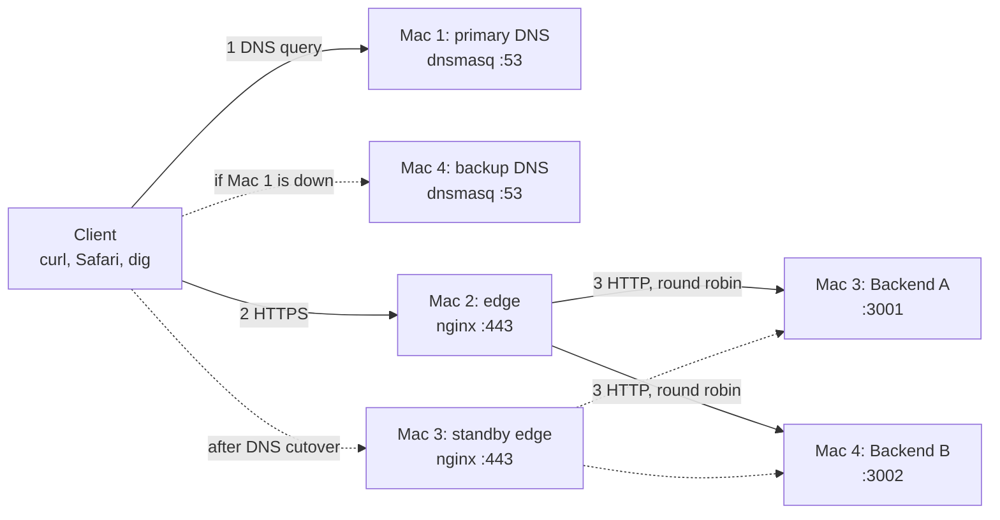

# Private Network Service Platform

Computer Networks capstone, Team 1. Four MacBooks on one Wi-Fi network run a
small but complete service platform:

- a **private DNS** zone (`team1.test`) with a backup server,
- an **HTTPS edge** that terminates TLS with a certificate from our own CA and
  load-balances over two backends,
- two **backend services**, one of them locked down by a host firewall,
- a **standby edge** that traffic can be moved to by changing one DNS record,
- scripts, tests, a layer-by-layer diagnosis tool and recorded evidence for all
  of it.

## How a request travels



1. The client asks our DNS server for `app.team1.test` and gets the edge address (TTL 30 s).
2. It opens TCP to port 443 and completes TLS. The certificate is signed by *Team1 Local CA*, which the client trusts, so no `-k` is needed.
3. nginx forwards the request over plain HTTP to Backend A or B and adds `X-Backend`, `X-Edge` and `X-Upstream` headers so you can see who answered.

## Machines

| Mac | Role | Ports |
|---|---|---|
| Mac 1 | Primary DNS (dnsmasq), client | UDP/TCP 53 |
| Mac 2 | HTTPS edge: TLS termination, load balancer, private CA | TCP 443 |
| Mac 3 | Backend A, standby edge (Ext E), backend firewall (Ext C) | TCP 3001, 443 |
| Mac 4 | Backend B, backup DNS (Ext A), main test client | TCP 3002, UDP 53 |

Addresses are not hard-coded in the scripts. Every script reads
[`config.env`](config.env); change an address there and re-run.

## What is implemented

| | Requirement | Where |
|---|---|---|
| Task A | All Macs on one private LAN | `evidence/01-lan/` |
| Task B | Private DNS for `team1.test` | `dns/start-dns.sh`, `dns/set-client-dns.sh` |
| Task C | Two backend services | `backend/backend.py` |
| Task D | Load balancing at the edge | `edge/nginx-script.sh` |
| Task E | HTTPS with our own CA | `edge/mac2-certs.sh`, `client/mac4-client-setup.sh` |
| Task F | HTTP caching (`Cache-Control`, `ETag`, `304`) | `backend/backend.py` |
| Task G | Packet capture of DNS, TCP and TLS | `client/mac4-task-g-capture.sh`, `demo.sh capture` |
| Ext A | Backup DNS on Mac 4 | `dns/mac4-backup-dns.sh`, `dns/backup-dns-demo.sh` |
| Ext B | 30 s TTL and resolver caching | `dns/ttl-demo.sh` |
| Ext C | Backend isolation with the macOS packet filter | `firewall/backend-firewall.sh`, `firewall/mac4-ext-c-firewall.sh` |
| Ext D | Backend failover without client errors | `edge/nginx-script.sh`, `edge/mac2-ha-demo.sh` |
| Ext E | Standby edge and DNS cutover | `edge/mac3-standby-edge.sh`, `dns/cutover-demo.sh`, `edge/mac2-edge-watch.sh` |
| Ext F | Layer-by-layer fault diagnosis | `troubleshoot/diagnose.sh`, `troubleshoot/RUNBOOK.md` |

## Getting started

You need macOS, Python 3 and Homebrew. The scripts install or expect
`dnsmasq` and `nginx`; Wireshark is optional (used for the packet walkthrough).

```bash
git clone https://github.com/thetanishgarg/CN_Project.git
cd CN_Project
```

1. **Put all four Macs on the same Wi-Fi** and check each address with `ipconfig getifaddr en0`.
2. **Set the addresses** in `config.env` on one Mac, commit, and have everyone `git pull`.
3. **Prepare each Mac.** `demo.sh` detects which Mac it is running on from the address in `config.env`:

   ```bash
   ./demo.sh ready      # start this Mac's services, reset to a clean state, run its tests
   ./demo.sh check      # 10-second pre-flight, no sudo
   ./demo.sh logs       # this Mac's live log window
   ```

4. **Run the demonstration** step by step (`./demo.sh 1` to `./demo.sh 10`, plus `9a`, `9b`, `9c`, `9e` for Phase 2). Each step pauses where another Mac has to act and prints what to say.
5. **Clean up** afterwards with `./demo.sh cleanup`.

Certificates: `./edge/mac2-certs.sh` on Mac 2 creates the CA and the server
certificate. Clients trust the CA once with `./client/mac4-client-setup.sh team1-ca.crt`.
The CA's private key never leaves Mac 2 and private keys are git-ignored.

## Testing

Each Mac has its own script. Run it after `./demo.sh ready`:

| Mac | Command |
|---|---|
| Mac 1 | `./tests/test-mac1.sh` |
| Mac 2 | `./tests/test-mac2.sh` |
| Mac 3 | `./tests/test-mac3.sh` |
| Mac 4 | `./tests/test-mac4.sh` |

Every check prints `PASS`, `FAIL` (with the fix underneath) or `WARN` (an optional
part that is not switched on). Runs are saved to `evidence/test-results/`.
Details: [tests/README.md](tests/README.md).

## When something breaks

```bash
./troubleshoot/diagnose.sh
```

checks DNS, IP, TCP, TLS and HTTP in that order and stops at the first layer
that fails, naming the likely cause and the fix. The fault table is in
[troubleshoot/RUNBOOK.md](troubleshoot/RUNBOOK.md).

## Evidence

[`evidence/EVIDENCE.pdf`](evidence/EVIDENCE.pdf) is the master document: one
request followed packet by packet, and a section per task and extension. Every
figure names the file and lines it comes from and says whether it was recorded
on the four-Mac network, taken from the packet capture, or run on one Mac.

At the time of writing, 12 of the 14 requirements are fully proven and two
(backup DNS switch-over, timed fault drill) are partly proven.
[`evidence/AUDIT.md`](evidence/AUDIT.md) lists what is still missing and
[`evidence/README.md`](evidence/README.md) maps every folder to its requirement
and explains how to rebuild the document with `evidence/build/build.sh`.

## Repository layout

```
config.env              addresses, ports and TTL shared by every script
backend/backend.py              the backend service (run twice: A on 3001, B on 3002)
edge/nginx-script.sh         generates and runs the nginx edge (primary or standby)
demo.sh                 one entry point for all four Macs
setup.sh                Phase 1 per-Mac setup
mac2-*.sh               Mac 2: certificates, HA demo, edge watcher
edge/mac3-standby-edge.sh    Mac 3: standby edge
mac4-*.sh               Mac 4: backend B, backup DNS, client setup, firewall, capture
dns/                    dnsmasq generation, client DNS, TTL, backup and cutover demos
firewall/               pf anchor for backend isolation
tests/                  one automated test script per Mac
troubleshoot/           diagnose.sh and the fault runbook
evidence/               recorded evidence, the evidence document and its build scripts
report/                 final report (LaTeX and PDF) and presentation
team1-ca.crt            the team CA certificate (public; clients must trust it)
```

## More documentation

| File | Contents |
|---|---|
| [ARCHITECTURE.md](ARCHITECTURE.md) | Topology, request flows, protocol layers, viva guide |
| [DEMO-SCRIPT.md](DEMO-SCRIPT.md) | The 11 demonstration steps with commands |
| [MAC2-PHASE2.md](MAC2-PHASE2.md) | Ext D and Ext E: how failover and cutover work |
| [PHASE2-REPORT.md](PHASE2-REPORT.md) | Phase 2 results and learning summaries |
| [REVISION-NOTES.html](REVISION-NOTES.html) | Revision notes for the viva |
| [report/report.pdf](report/report.pdf) | Final report |
